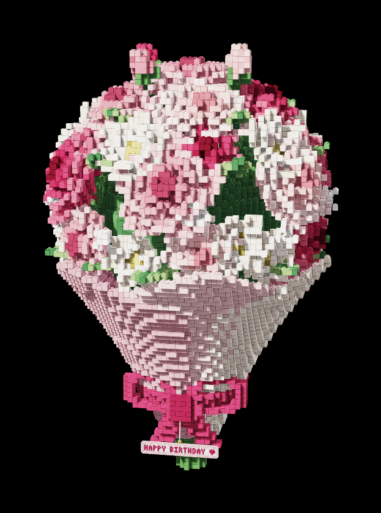
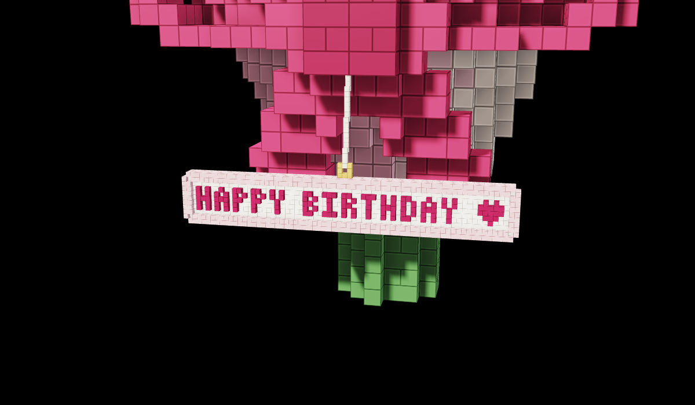
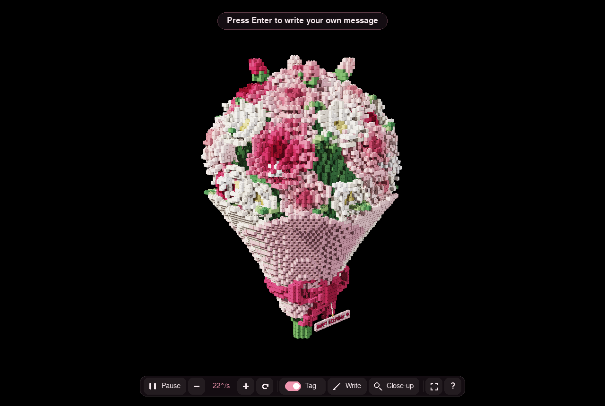

# Voxel Bouquet

**A 3D flower bouquet built entirely from bricks, rotating in real time, with a tiny gift tag that carries your own message.**

<p align="center">
  
  &nbsp;
  
</p>

<p align="center">
  
</p>

Every rose petal, leaf, stem, fold of paper and ribbon loop is made of square, stud-topped bricks on a single voxel grid, then rendered on the GPU with glossy plastic shading, soft shadows and ambient occlusion.

---

## Features

- **Fully 3D, real-time**: a genuine 360° rotation, not a flat image. Drag to turn it, scroll to zoom.
- **Brick-built bouquet**: 23 roses in dusty pink, blush and deep rose, plus ivory blooms, buds, baby's breath and stepped leaves. It sits in a folded, layered paper wrap with a ribbon and bow.
- **Your message on a tag**: press **Enter**, type a sentence, and it appears in raised pixel lettering on a tiny tag tied to the bow. The tag updates live as you type, and long messages wrap onto up to three lines.
- **Animated tag toggle**: press **Tab** and the tag unfurls from the knot with a gentle swing. Press it again and the tag shrinks away.
- **Clean, unobtrusive controls**: a small clickable bar fades out when you're not using the mouse. The full control list is one click away.
- **Studio look**: a black background, soft key, fill and rim lights, glossy plastic highlights and real shadows.

<p align="center">
  
  
</p>

---

## Quick start

### 1. Install Python (once)
Download it from **[python.org/downloads](https://www.python.org/downloads/)**.
On Windows, tick **"Add python.exe to PATH"** during setup.

### 2. Download Voxel Bouquet
**[⬇ Download the ZIP](https://github.com/ghxfo/voxel-bouquet/archive/refs/heads/main.zip)** and unzip it.

### 3. Open it
| Windows | Mac |
|---|---|
| Double-click **`run_windows.bat`** | Double-click **`run_mac.command`** <br><sub>If your Mac blocks it: right-click → **Open** → **Open**</sub> |

The first launch installs what it needs (about a minute). After that it opens straight away.

<details>
<summary><b>Prefer the terminal?</b></summary>

```bash
pip install -r requirements.txt
python voxel_bouquet.py
```

Options:

```bash
python voxel_bouquet.py --text "HAPPY BIRTHDAY *"   # start with your message
python voxel_bouquet.py --no-tag                     # start without the tag
python voxel_bouquet.py --speed 30                   # rotation speed (degrees per second)
python voxel_bouquet.py --size 1600x1000             # window size
python voxel_bouquet.py --maximized                  # or --fullscreen
```
</details>

---

## Controls

| Action | Mouse / bar | Key |
|---|---|---|
| Write your message | **Write** | `Enter` |
| Show / hide the tag | **Tag** switch | `Tab` |
| Close-up of the tag | **Close-up** | `C` |
| Turn the bouquet | drag | |
| Zoom | scroll | |
| Reset the view | double-click | `0` |
| Pause / play | ❚❚ | `Space` |
| Slower / faster | − / + | `←` / `→` |
| Reverse direction | ↻ | `R` |
| Fullscreen | ⛶ | `F` |
| Maximise window | | `M` |
| Smaller / bigger window | | `[` / `]` |
| Shadows on / off | | `S` |
| All controls | **?** | `H` |
| Quit | close the window | `Q` |

**Messages** can use letters, numbers, spaces and `- . , ! ? ' & +`. Type `*` to draw a heart ❤. Messages can be up to 40 characters long.

---

## Customising

All the settings live in the **PARAMETERS** section at the top of [`voxel_bouquet.py`](voxel_bouquet.py):

| Setting | What it changes |
|---|---|
| `TAG_DEFAULT_TEXT` | The message shown when the app opens |
| `ROTATION_SPEED_DEG` | Default rotation speed |
| `START_WITH_TAG` | Whether the tag is shown at start |
| `PALETTE` | Every colour: rose shades, greens, wrapping, ribbon, tag |
| `WINDOW_SIZE`, `FILL_FRACTION` | Window size and how much of it the bouquet fills |
| `TAG_PIXEL`, `TAG_MAX_WIDTH` | Size of the tag and its lettering |
| `SHADOW_MAP_SIZE`, `MSAA_SAMPLES` | Quality settings (lower them for older computers) |

---

## How it works

1. **Voxel grid**: the bouquet lives in a 3D grid of about 700,000 cells. Each cell is either empty or holds one coloured brick.
2. **Shapes from mathematics**: every part is described by a geometric rule, and each cell that satisfies the rule gets a brick:
   - **Placement**: flowers sit on an invisible dome, placed with *spherical coordinates*, and are tilted outward with *rotation matrices*.
   - **Roses**: these use *polar coordinates*. The petal rings widen along a *parabola*, and *modular arithmetic* splits each ring into separate petals.
   - **Leaves and ivory blooms**: leaves follow a *sine* profile, and ivory petals are *ellipses*.
   - **Wrapping**: the wrap is a *cone* with a gentle quadratic flare.
3. **Meshing**: only visible brick faces are kept. Neighbouring bricks are paired into 1×2 bricks in a running bond, studs are added to exposed tops, and each corner is shaded by *ambient occlusion*.
4. **Rendering**: the GPU draws the bouquet with Blinn-Phong plastic shading, Fresnel reflections, a 2048² *shadow map* and 4× MSAA. About 60 times a second the model turns by *speed × time*.
5. **The tag**: each character is a 5-row pixel glyph turned into raised micro-bricks. The tag is rebuilt instantly whenever the text changes, and its toggle animation is a scale ease with a damped pendulum swing.

Built with **Python**, **[ModernGL](https://github.com/moderngl/moderngl)** (OpenGL 3.3), **[pygame-ce](https://github.com/pygame-community/pygame-ce)** and **NumPy**.

---

## Troubleshooting

| Problem | Fix |
|---|---|
| `Failed to build 'pygame'` | Install **`pygame-ce`** instead: `pip install pygame-ce`. The launchers already do this. |
| `python` is not recognised (Windows) | Reinstall Python and tick **"Add python.exe to PATH"**, or use the `run_windows.bat` launcher. |
| Black window, or it closes immediately | Update your graphics driver. The app needs OpenGL 3.3. |
| Low frame rate | Press `S` to turn off shadows, or lower `SHADOW_MAP_SIZE` / `MSAA_SAMPLES`. |

---

<sub>Voxel Bouquet is an independent fan project. It is not affiliated with, sponsored by or endorsed by the LEGO Group. LEGO® is a trademark of the LEGO Group.</sub>
